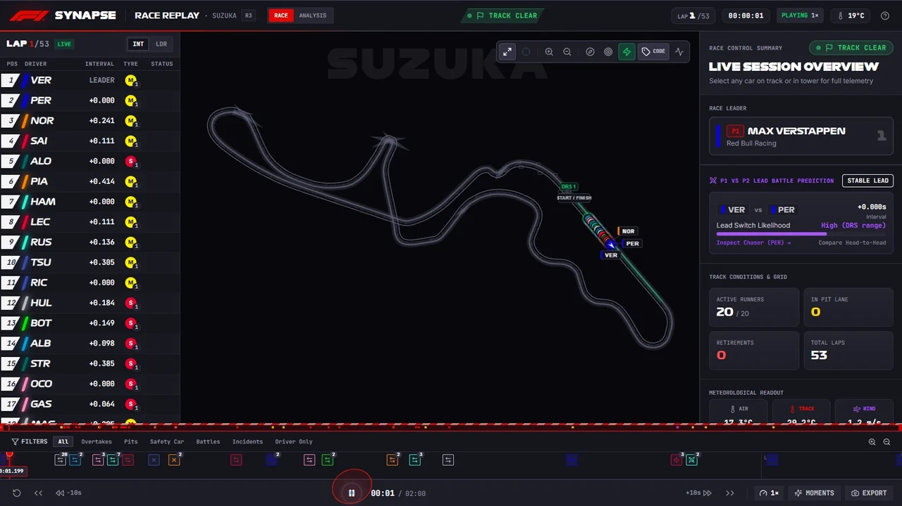

<!--
  Every graphic here is a hand-built SVG from scripts/build.py (run it after editing).
  The season chart is redrawn daily by .github/workflows/season.yml.
-->

<picture>
  <source media="(prefers-color-scheme: dark)" srcset="https://raw.githubusercontent.com/Sackedball/Sackedball/main/assets/hero-dark.svg">
  <source media="(prefers-color-scheme: light)" srcset="https://raw.githubusercontent.com/Sackedball/Sackedball/main/assets/hero-light.svg">
  
</picture>

I'm Soham, a student in Mumbai. I like pulling data and code apart to see how they work, and right now that means Formula 1: timing, telemetry, tyres and strategy. Everything above is drawn from scratch. The speed trace is simulated from the little circuit beside it.

<picture>
  <source media="(prefers-color-scheme: dark)" srcset="https://raw.githubusercontent.com/Sackedball/Sackedball/main/assets/bench-dark.svg">
  <source media="(prefers-color-scheme: light)" srcset="https://raw.githubusercontent.com/Sackedball/Sackedball/main/assets/bench-light.svg">
  
</picture>

Recorded from F1 Synapse running on my machine: the first seconds of the Japanese GP at Suzuka, replayed at 1× from the race's cached timing data.

**[F1 Synapse](https://github.com/Sackedball/f1-synapse)** replays real Formula 1 races lap by lap, with live telemetry, tyre and weather data, and predictions for battles and strategy. Python, FastF1 and scikit-learn handle the data and models. React, TypeScript and PixiJS draw the race.

**[Source on GitHub](https://github.com/Sackedball/f1-synapse)** &nbsp;/&nbsp; Also here: [Data-Science-Projects](https://github.com/Sackedball/Data-Science-Projects), my notebooks in Python and Jupyter.

<picture>
  <source media="(prefers-color-scheme: dark)" srcset="https://raw.githubusercontent.com/Sackedball/Sackedball/main/assets/setup-dark.svg">
  <source media="(prefers-color-scheme: light)" srcset="https://raw.githubusercontent.com/Sackedball/Sackedball/main/assets/setup-light.svg">
  
</picture>

<picture>
  <source media="(prefers-color-scheme: dark)" srcset="https://raw.githubusercontent.com/Sackedball/Sackedball/output/season-dark.svg">
  <source media="(prefers-color-scheme: light)" srcset="https://raw.githubusercontent.com/Sackedball/Sackedball/output/season-light.svg">
  
</picture>

Say hello on [LinkedIn](https://www.linkedin.com/in/soham-kokate-/).

<picture>
  <source media="(prefers-color-scheme: dark)" srcset="https://raw.githubusercontent.com/Sackedball/Sackedball/main/assets/footer-dark.svg">
  <source media="(prefers-color-scheme: light)" srcset="https://raw.githubusercontent.com/Sackedball/Sackedball/main/assets/footer-light.svg">
  
</picture>
